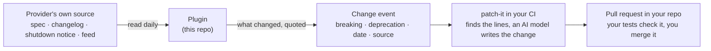

# patch-it-plugins

**How patch-it notices, on its own, that something your code depends on changed.** Each plugin watches one provider's own source (an API spec, a changelog, a shutdown notice, a release feed) and turns what changed into a change event, with the source linked and quoted.

**Why:** when anything your code depends on changes (APIs, packages, SDKs, runtimes, CI, AI models), [patch-it](https://patch-it.dev) finds the code that breaks and opens the pull request that fixes it. In your CI, on your key. You get the fix, not the alert. These plugins are the trigger: nobody has to assign an alert or open a ticket.

[](https://github.com/patch-it-dev/patch-it-plugins/actions/workflows/CI_go.yml)
[](https://pkg.go.dev/github.com/patch-it-dev/patch-it-plugins)
[](go.mod)
[](LICENSE)
[](docs/plugins.md)
[](https://docs.patch-it.dev)
[](https://github.com/patch-it-dev/patch-it-plugins/discussions)



## What patch-it does

1. **It acts on its own.** A plugin here sees the change where the provider announces it, and patch-it starts from there: no alert to triage, no ticket to assign. That includes changes that never bump a version, like an AI model or an API shut down on a date.
2. **It writes the fix.** An AI model (on your own key) reads the change and the lines it affects and writes the code change. Your repo's own tests check it, and it arrives as a pull request you review and merge like any other: the code change, not just the version.
3. **Proof:** 8 pull requests opened by the early version have been merged by outside maintainers.
4. **What it covers:**

   | Layer | Status |
   |---|---|
   | APIs (Stripe, OpenAI, Anthropic and [more](docs/plugins.md)) | live |
   | AI models (shutdowns and retirements) | live |
   | Packages and SDKs (breaking major releases) | in testing |
   | Runtimes (end of life) | building |
   | CI (retired runners, images, actions) | planned |

5. **Start:** [docs.patch-it.dev](https://docs.patch-it.dev) sets up the GitHub Action in your repo. To have it watch a provider it doesn't cover yet, add a plugin (below).

## Add a provider in 15 minutes

You need Go (the version in `go.mod`), `make` and Python 3. Pick the format that reads your provider's source ([which one](docs/writing-a-plugin.md#3-pick-the-format-plugin)), then:

**1. Scaffold it.**

```sh
URL=https://acme.example/changelog.xml   # your provider's source
go run ./cmd/new-plugin --api acme --provider Acme --format feed --source "$URL"
```
```
Scaffolded acme (Acme, format feed):
  docs/plugins.md
  plugins/feed/acme.go (new)
  plugins/feed/acme_test.go (new)
  ...
Next steps (every place to fill in says TODO(new-plugin): ...)
```

**2. Save a real copy of the source and write the golden file.** Fill in the `TODO(new-plugin)`s: the reader in `plugins/feed/acme.go`, the saved file's row in `testdata/README.md`, and "Why this source" in `providers/acme.md`.

```sh
curl -fsSL -o plugins/feed/testdata/acme.rss.xml "$URL"
go test ./plugins/feed -run TestAcme -update   # writes testdata/golden/acme.json: read it like code
```

**3. Check it, the way CI will.**

```sh
make plugins-json && make check
```
```
...
make check: all passed
```

**4. Open the pull request** (`git commit -s`, one plugin per PR). Details: [docs/writing-a-plugin.md](docs/writing-a-plugin.md). Stuck? Ask in [Discussions](https://github.com/patch-it-dev/patch-it-plugins/discussions). Looking for a first change? [Good first issues](https://github.com/patch-it-dev/patch-it-plugins/issues?q=is%3Aissue+is%3Aopen+label%3A%22good+first+issue%22).

## How a plugin works

1. **Fetch.** The plugin asks its environment for the source (`env.Get`); it never opens connections itself. Pages that change in place are also cited through a Web Archive snapshot, so the link in an event keeps showing what the plugin read.
2. **Compare.** It compares the source to the last version it saw (the baseline): two OpenAPI specs, two versions of a deprecations page, a new release's changelog section.
3. **Emit events.** Each change becomes one event in [patch-it's change-event format](https://github.com/patch-it-dev/patch-it/tree/main/docs/contract): what changed, how bad it is (breaking, deprecation, behavior change, non-breaking), the date it takes effect, and the source URL with a quote. **No source, no event.** When unsure, a plugin emits nothing: a wrong event would become a wrong pull request.

Most providers are an entry for a shared format plugin (`openapi`, `retirements`, `migrationguide`, `removedmembers`, `changelog`, `feed`, `apichangelog`, `catalog`), not new code. patch-it's hosted ingestion service runs every plugin daily and serves the events to the patch-it GitHub Action and CLI.

## Supported plugins

**[docs/plugins.md](docs/plugins.md)** lists every plugin: provider, layer, what it watches, its source. The same list is on [docs.patch-it.dev](https://docs.patch-it.dev/supported-apis/plugins/), and as JSON in [docs/plugins.json](docs/plugins.json) (`make plugins-json`).

## Layout

| Path | What's there |
|---|---|
| [`plugin/`](plugin/) | The `Plugin` interface, the registry (`Register`, `Lookup`, `Names`), `Env`, `Result` |
| [`plugins/`](plugins/) | The format plugins; `plugins/all` imports every one |
| [`cmd/new-plugin/`](cmd/new-plugin/), [`cmd/list-plugins/`](cmd/list-plugins/) | The starter for a new provider; the generator of `docs/plugins.json` |
| [`kit/`](kit/), [`kit/kittest/`](kit/kittest/) | What plugins share (the unchanged-page check, Wayback citing) and the test kit (in-memory store, saved pages, golden files) |
| [`event/`](event/), [`migrate/`](migrate/) | The change-event types of [patch-it's contract](https://github.com/patch-it-dev/patch-it/tree/main/docs/contract), and the v1 → v2 conversion |
| [`diff/`](diff/), [`normalize/`](normalize/), [`hint/`](hint/), [`adapter/`](adapter/) | The OpenAPI diff engine: compare two specs, turn the changes into events, attach changelog hints; one adapter per spec provider |
| [`retire/`](retire/), [`sdkguide/`](sdkguide/), [`fetch/`](fetch/) | The deprecations-page and migration-guide readers; the HTTP fetch and cache |
| [`contract/fixtures/`](contract/) | A copy of patch-it's change-event fixtures |
| [`providers/`](providers/) | One page per provider: why that source, what the plugin reads |
| [`docs/`](docs/) | [The plugin list](docs/plugins.md), [how to write a plugin](docs/writing-a-plugin.md), the [README template](docs/README-template.md) patch-it's public repos share |

## Run the checks

```sh
make check           # what CI runs: tidy, build, gofmt, vet, import and net/http guards, go test -race, no TODO(new-plugin) left, leak guard
```

The tests are offline: every plugin's test reads a saved copy of its source from `testdata/` and compares the events with a golden file. After an intended change to a plugin's output, `go test ./plugins/<name> -update` rewrites its golden files; review that diff like code.

`GITHUB_TOKEN` (optional, no scopes) only raises GitHub's rate limit when the `openapi` adapters look up release tags; the tests never use it. Nothing else is read from the environment.

## Releases

Releases are `v0.x.y` tags on `main` with a [GitHub release](https://github.com/patch-it-dev/patch-it-plugins/releases) and generated notes. The **Release** workflow tags a patch release on its own every Monday and Thursday at 14:00 UTC when something new was merged, and maintainers can run it by hand ([how](CONTRIBUTING.md#releasing)). patch-it's hosted ingestion service runs the latest release, so a merged plugin is running within a few days. Tags are never moved or deleted.

```sh
go get github.com/patch-it-dev/patch-it-plugins@latest
```

## Contributing

New providers and fixes are welcome: [CONTRIBUTING.md](CONTRIBUTING.md) has the rules (DCO sign-off, golden tests, the plugin list), [docs/writing-a-plugin.md](docs/writing-a-plugin.md) the how-to. AI coding agents: [AGENTS.md](AGENTS.md). Questions and ideas: [Discussions](https://github.com/patch-it-dev/patch-it-plugins/discussions).

## License

[Apache-2.0](LICENSE), copyright patch-it contributors.
