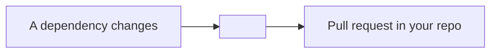

# README template for patch-it's public repos

Every public patch-it repo's README has the same shape, so a developer landing on any of them knows in ten seconds what it is and how to try it. This repo's [README](../README.md) is the worked example. Copy the skeleton at the bottom, then fill each section using the notes.

## The sections, in order

| # | Section | What goes in it |
|---|---|---|
| 1 | **What** (one line, bold, under the title) | What *this repo* is, in one sentence, in the product's words. For a part of patch-it, say which part of the story it is ("how patch-it notices, on its own, that something changed"). |
| 2 | **Why** (one short paragraph) | The one-liner for patch-it: when anything your code depends on changes (APIs, packages, SDKs, runtimes, CI, AI models), patch-it finds the code that breaks and opens the pull request that fixes it. In your CI, on your key. "You get the fix, not the alert." Then one sentence on why this repo matters to that. |
| 3 | **Badges** (one line of them) | The badge set below, in that order. |
| 4 | **Visual** | One picture of the flow: a mermaid diagram (GitHub renders it) until there's a GIF or screenshot. Left to right, ending in "pull request in your repo". |
| 5 | **The story** ("What patch-it does") | In this order, one or two lines each: (1) **it notices on its own** (it watches the change itself; no one assigns an alert; also changes with no version bump, like a model or API shut down on a date); (2) **it writes the fix** (an AI model on your key writes the code change, your CI runs your tests on the pull request like any PR, you review and merge it; never say patch-it tests the fix); (3) **proof** ("8 pull requests merged by outside maintainers", no other counts); (4) **layers covered**, as a table with two status columns, **Noticed** (a plugin watches it) and **Fixed** (patch-it writes the PR), each `live`, `in testing`, `building` or `planned`, never ahead of the truth; (5) **how to start** (a link to docs.patch-it.dev). |
| 6 | **Quickstart** (three or four steps, one screen) | The shortest path from a clean clone to the repo's main job, each step a command that runs as written, with the output to expect. Details live in linked docs. |
| 7 | **How it works, and links** | A short "how it works", the layout if the repo has code, how to run its checks, releases, contributing (with Discussions and good first issues), license, and docs.patch-it.dev. |

## The badge set

In this order; drop one only if it can't be honest for the repo (no release yet: no release badge):

1. **CI**: the main workflow's badge, `https://github.com/patch-it-dev/<repo>/actions/workflows/<workflow>.yml/badge.svg`.
2. **Package reference**, if it's a library: Go Reference (`https://pkg.go.dev/badge/<module>.svg`), PyPI or npm version.
3. **Language version**: e.g. `https://img.shields.io/github/go-mod/go-version/patch-it-dev/<repo>`.
4. **Latest release**, once there is one: `https://img.shields.io/github/v/release/patch-it-dev/<repo>`.
5. **License**: `https://img.shields.io/badge/license-<spdx>-3f5bf0`.
6. **A count the repo is about**, only if a test keeps it right (patch-it-plugins: the plugins badge, set by `make plugins-json` and checked by `go test`).
7. **Docs**: `https://img.shields.io/badge/docs-docs.patch--it.dev-3f5bf0`.
8. **Discussions**: `https://img.shields.io/github/discussions/patch-it-dev/<repo>`.

Static badges use the brand accent, `3f5bf0` (`accent`, light theme, in the brand tokens).

## Words

- Say "patch-it" (lowercase), and refer to Patchy as "Patchy" or "patch-it", never "he".
- Always list the layers; never describe patch-it as API-only.
- Use: "on its own", "writes the fix", "the code change, not just the version", "you review and merge".
- Don't name version-bump bots in headlines, the first lines or repo descriptions, and don't write "better than", "killer" or "magic". A factual comparison belongs on the docs' comparison page only.
- A public README never mentions private repos, internal services or pricing that isn't public. The service that runs plugins is "patch-it's hosted ingestion service".

## Images

Use only images that are already public, linked by URL, never copied in: Patchy and the wordmark from the organization profile, `https://raw.githubusercontent.com/patch-it-dev/.github/main/profile/assets/<file>.svg` (`bot-asleep`, `bot-found-one`, `bot-merged`, `bot-excited`, `patchy-night-shift`, `wordmark-plain-on-light`, `wordmark-plain-on-dark`). Give every image alt text that says what it shows. No gradients, glows or starry skies.

## Skeleton

````markdown


# <repo>

**<What this repo is, in one line.>**

**Why:** when anything your code depends on changes (APIs, packages, SDKs, runtimes, CI, AI models), [patch-it](https://patch-it.dev) finds the code that breaks and opens the pull request that fixes it. In your CI, on your key. You get the fix, not the alert. <Why this repo matters to that.>

<badges, in the order above>



## What patch-it does

1. **It notices on its own.** ...
2. **It writes the fix.** ...
3. **Proof:** 8 pull requests opened by the early version have been merged by outside maintainers.
4. **What it covers:**

   | Layer | Noticed | Fixed |
   |---|---|---|
   | APIs | live | live |
   | AI models | live | live |
   | Packages and SDKs | live | in testing |
   | Runtimes | live | building |
   | CI | live | planned |

5. **Start:** [docs.patch-it.dev](https://docs.patch-it.dev).

## <Quickstart: the repo's main job in three or four steps>

## How it works

## Contributing

## License
````

Keep the layer statuses the same in every repo, and change them everywhere at once when one moves.

## When a repo goes public

The README is half of it. The same day, in the repo's settings:

1. **Description**: one line in the same words (what the repo is, the layers, "You get the fix, not the alert"), under 350 characters, no version-bot names, never API-only.
2. **Website**: `https://docs.patch-it.dev` (or the page in the docs about this repo).
3. **Topics**: from `dependencies`, `breaking-changes`, `api-changes`, `api`, `sdk`, `ai-models`, `ci`, `pull-requests`, `automation`, plus the repo's language and what it is (`go`, `plugins`, `documentation`, …).
4. **Discussions** on, if people will ask questions there; keep the categories Q&A, Ideas, Show and tell and Announcements.
5. **Social preview** (Settings → General → Social preview; GitHub has no API for it): a 1280×640 PNG, dark background from the brand tokens, the plain wordmark, Patchy on a cream tile, IBM Plex, the repo's one line. No gradients or glows.
6. Check a shared link to the repo shows its own card.
